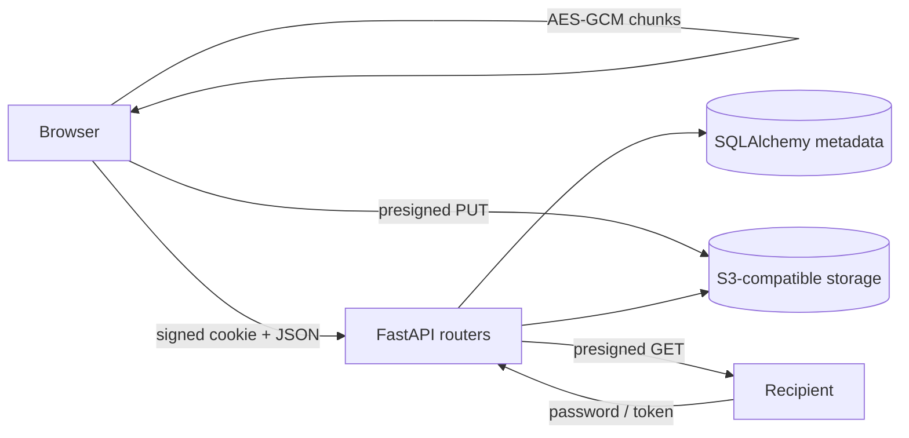

# VaultDrop

[Leia em portugues](README.pt-BR.md) | **English**

 

Resumable, end-to-end encrypted file sharing with S3 multipart uploads, signed local sessions, and expiring or download-limited links.

## Why it exists

The difficult parts are not the upload or download URLs; they are ownership, reserved quota, interrupted multipart state, encrypted chunk boundaries, and concurrent download limits. VaultDrop makes those paths explicit and testable.



## Quickstart

```bash
uv sync --locked --python 3.12
cp .env.example .env
uv run uvicorn vaultdrop.api:app --host 127.0.0.1 --port 8000
```

Register with `POST /v1/auth/register`, then use the returned HttpOnly signed cookie. The static UI is available at `http://127.0.0.1:8000`.

Local S3-compatible Compose stack:

```bash
docker compose up --build -d
```

It uses `127.0.0.1:55001` for the app and `127.0.0.1:55000` for Moto.

## Design decisions

- **Real local authentication:** Argon2 password hashes and locally issued HMAC-signed, expiring cookies replace the former spoofable user header.
- **Module boundaries:** routers, services, repositories, S3, planning, and models separate HTTP, policy, persistence, and object storage.
- **Multipart state:** the API lists uploaded parts, records per-part ETag and SHA-256 metadata, resumes presigned parts, and exposes idempotent complete/abort operations.
- **Streaming verification:** completed objects are hashed from an S3 streaming body in 1 MiB reads; the application does not buffer the object.
- **Atomic usage:** initiation reserves bytes in the metadata transaction, so concurrent initiations and unfinished uploads count against quota.
- **Share limits:** expiry and maximum downloads are checked before a conditional SQL slot update; password attempts are source-IP rate-limited in a 15-minute window.
- **Encryption:** the browser encrypts fixed chunks with AES-GCM, unique 12-byte nonces, and chunk index plus final flag as additional authenticated data. The key remains in the URL fragment.

## Testing

The Python suite exercises Moto S3, real HTTP routes, SQL races, cross-user ownership, password shares, resumable parts, stale sweeps, and Hypothesis part planning. The Node suite exercises AES-GCM tamper, reorder, and truncation failures.

Commands used:

```bash
uv run pytest tests -q --cov=vaultdrop --cov-report=term-missing
uv run ruff check .
uv run mypy --strict vaultdrop tests
node --test tests/crypto.test.js
tofu fmt -check -recursive terraform
tofu -chdir=terraform init -backend=false
tofu -chdir=terraform validate
actionlint
```

The latest local Python run passed 15 tests with 91% statement coverage on this Apple Silicon laptop. The Node run passed 4 crypto tests. The OpenTofu stack initialized and validated; it was not applied. Docker Compose build/start was attempted but did not complete within the local verification window, so it is recorded as not verified.

## Limitations

Signed cookies are suitable for a locally managed deployment, not a hosted multi-tenant identity system. SQLite is not a PostgreSQL concurrency reference; PostgreSQL `SELECT FOR UPDATE` and conditional updates are the production-oriented paths. Presigned download URLs expose object storage until expiry and do not replace application-level authorization on the S3 bucket.

## License

MIT. See [LICENSE](LICENSE).

Built by [Chico Oliveira](https://github.com/FrancisWorld)
