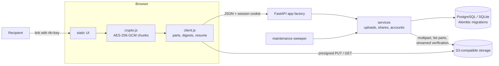

# VaultDrop

[Leia em português](README.pt-BR.md) | **English**

 

Encrypted, expiring file sharing on S3: the browser encrypts with AES-256-GCM, uploads resumable multipart parts straight to storage, and recipients decrypt with a key that only ever lives in the link's `#` fragment.

## Why it exists

Presigned URLs are the easy part. The hard parts are the places where concurrent or interrupted requests quietly break guarantees, and this project makes each of them explicit and tested against a real database:

- **Download limits and quotas under races.** A share with `max_downloads=5` hit by 25 simultaneous requests must hand out exactly 5; ten simultaneous 400 MiB reservations against a 1 GiB quota must admit exactly two.
- **Password guessing.** Failed guesses have to be counted even though the request fails, and counted exactly even when 30 arrive at once.
- **Multipart state.** Uploads get interrupted. Resuming needs storage's view of the parts, fresh presigned URLs, per-part digests, and completion that is idempotent even when two tabs race or the server dies between "storage assembled the object" and "database committed".
- **Integrity without buffering.** The server verifies SHA-256 by streaming the stored object in 1 MiB reads, producing the whole-object digest and every per-part digest in one pass.
- **Crypto framing.** Chunks are authenticated with their index and a final flag, so reordering, dropping, duplicating or extending chunks fails; encryption is deterministic per file key so a crashed upload can resume.



## Quickstart (SQLite, no containers)

Commands below were run on an Apple Silicon laptop (8 GB). The development database is SQLite; storage needs any S3-compatible endpoint, for example `moto_server` or the Compose stack below.

```bash
uv sync --locked --python 3.12
export AWS_ACCESS_KEY_ID=replace-me AWS_SECRET_ACCESS_KEY=replace-me
export VAULTDROP_S3_BUCKET=vaultdrop-local VAULTDROP_S3_ENDPOINT=http://127.0.0.1:9000 \
       VAULTDROP_S3_PATH_STYLE=true VAULTDROP_S3_BOOTSTRAP=true VAULTDROP_S3_SSE= \
       VAULTDROP_COOKIE_SECURE=false VAULTDROP_ALLOWED_ORIGINS=http://127.0.0.1:8000
uv run uvicorn --factory vaultdrop.api:create_app --port 8000
```

The app migrates its own schema at start (`VAULTDROP_AUTO_MIGRATE=false` to run `alembic upgrade head` yourself). `VAULTDROP_S3_BOOTSTRAP=true` is a development convenience that creates the bucket and its browser CORS rules; in AWS the OpenTofu stack in `terraform/` owns both.

### Docker Compose (PostgreSQL + Garage S3 + app)

```bash
./scripts/dev-env.sh          # generates local-only credentials into .env (never committed)
docker compose up --build -d  # app on http://localhost:55001, S3 on :55100
node scripts/e2e.mjs http://127.0.0.1:55001
docker compose down --volumes
```

The stack runs PostgreSQL 17, [Garage](https://garagehq.deuxfleurs.fr/) v2.1.0 (a real S3 implementation, image pinned by digest) and the app. **Status: run end to end.** `docker compose up --build` brought up PostgreSQL 17, Garage and the app (init container exited 0, app healthy) and `node scripts/e2e.mjs` passed against it, as did the CI steps of the `compose-e2e` and `s3-integration` jobs run by hand on a macOS laptop (not on GitHub's runners). Browser CORS rules on Garage were checked with `curl`: an allowed origin is echoed back singly (`ETag` exposed) and another origin is rejected. Found and fixed during that run: the bucket CORS rule listed several origins in one rule and Garage echoed the whole list back, which browsers reject; bootstrap now writes one rule per origin.

### What was actually run end to end

`scripts/e2e.mjs` imports the browser's own `crypto.js` and `client.js`. It ran against the Compose stack above and, earlier, against uvicorn on native PostgreSQL 16 with `moto_server`; both passed with identical steps. Output of the second run:

```text
$ node scripts/e2e.mjs http://127.0.0.1:55001
- registered e2e-c5c7a610
- plaintext 20971643 bytes, sha256 5f7587b69f27988b...
- interrupted after part 1 (upload 49c3a123-8fcd-4b13-99b6-7456dac2db5b)
- resumed: 2 part(s) re-sent, stored 20972110 ciphertext bytes (sha256 e848250cf8545760...)
- share refuses a missing and a wrong password
- downloaded and decrypted: name restored, 20971643 bytes, sha256 matches
- wrong key rejected; download limit enforced
- audit trail: auth.registered, share.created, share.redeemed, upload.completed, upload.initiated, upload.part_recorded
e2e ok
```

That is Node, not a browser: the DOM glue in `app.js` and real browser CORS behaviour against the bucket are not exercised by any automated check here.

## API sketch

| Step | Call |
| --- | --- |
| Account | `POST /v1/auth/register`, `/login`, `/logout`, `GET /v1/auth/me` (HttpOnly, SameSite=Strict session cookie) |
| Start upload | `POST /v1/uploads` `{filename, size_bytes, part_size, sha256?}` + optional `Idempotency-Key` |
| Resume | `GET /v1/uploads/{id}` returns storage's parts and fresh URLs for the missing ones |
| Per-part digest | `POST /v1/uploads/{id}/parts/{n}` (checked against storage's ETag and size) |
| Finish | `POST /v1/uploads/{id}/complete`, `DELETE /v1/uploads/{id}` |
| Share | `POST /v1/files/{id}/shares` `{password?, expires_in_seconds?, max_downloads?}`, `DELETE /v1/shares/{id}` |
| Redeem | `POST /v1/shares/redeem` `{token, password?}`, then GET the presigned URL; `/s/{token}` serves the UI |
| Housekeeping | `DELETE /v1/files/{id}`, `GET /v1/audit`, `POST /v1/uploads/expired/sweep` |

## Design decisions and trade-offs

- **Sessions are server-side.** A random 256-bit token in an HttpOnly cookie; only its SHA-256 is stored, so logout and expiry are enforced by the server and a leaked table cannot be replayed. There is no signing secret to leave at a placeholder value. Origin checking on state-changing requests backs up `SameSite=Strict`.
- **Rate limiting is a database ledger**, not process memory, so it holds across replicas. An attempt is committed before the (slow) Argon2 check, under a PostgreSQL advisory lock keyed by scope and source, which is what makes "exactly 5 of 30" true. Success clears the history. Wrong-password and rate-limited responses are distinct (403 and 429 with `Retry-After`); tokens are 256-bit, so existence is not a secret worth hiding.
- **Download slots** are claimed with one conditional `UPDATE ... WHERE downloads < max_downloads AND not expired`. A slot is consumed when the presigned URL is issued, not when bytes are fetched, and an attempt with the wrong decryption key still consumes one; the server cannot tell.
- **Quota** is checked under `SELECT ... FOR UPDATE` on the user row and counts stored files plus reservations of live uploads. Reservations expire with the upload (24 h by default) and a background sweeper (plus an owner endpoint) aborts them in storage. Byte counters are `BIGINT`: the earlier 32-bit columns would have overflowed at 2 GiB on PostgreSQL.
- **Presigned PUTs cannot cap part size**, so the server compares storage's listed part sizes with the plan before completing, and re-hashes the assembled object afterwards. A user cannot declare 1 byte and store 5 GiB.
- **Verification** accepts a whole-object digest declared up front (API clients), per-part digests recorded as parts are uploaded (the browser, which cannot hash a stream with WebCrypto), or both. At least one must exist. A mismatch deletes the object, marks the upload failed, releases the reservation, and the failure is committed before the error is returned.
- **Encryption format** (`crypto.js`): `"VDR1"`, an authenticated header carrying file name, type and plaintext size, then 1 MiB chunks with counter nonces and (index, final) as associated data. The server never sees the file name; it stores an opaque one.
- **Locks, not retries.** Completion locks the upload row, so racing completions return the same file; if the server dies after storage assembled the object but before commit, a retry detects the object and goes straight to verification.
- **SQLite is for development only**: every transaction is `BEGIN IMMEDIATE`, which serialises writers and makes the race tests pass trivially. PostgreSQL is where they mean something, and CI runs the whole suite on both.

## Testing strategy

| Layer | What | Where |
| --- | --- | --- |
| Concurrency on the real database | download limit, quota reservations, password and login throttles, completion, idempotency keys, part recording, registration, abort vs complete | `tests/test_concurrency.py` (SQLite and PostgreSQL) |
| PostgreSQL specifics | `BIGINT` columns, cascades, advisory locks, simultaneous migrations from separate processes | `tests/test_postgres.py` |
| Failure paths | storage outages on every operation, vanished uploads, crash-after-assemble recovery, oversized parts, bad digests, expired uploads, forged sessions, cross-user access | `tests/test_uploads.py`, `test_shares.py`, `test_auth.py` |
| Migrations | schema equals models (Alembic drift check), upgrade, downgrade, idempotence | `tests/test_migrations.py` |
| Security | CSP contents, origin guard, header injection, filename validation | `tests/test_security.py` |
| Properties | part planning and streaming hash equals naive hash (Hypothesis), bounded memory | `tests/test_planning.py`, `test_integrity.py` |
| Real S3 over HTTP | interrupted multipart resume, digest failure removes the object, abort, CORS exposure of `ETag` | `tests/test_s3_integration.py` |
| Browser modules | crypto tamper, reorder, truncation, extension, wrong key; resume without re-sending parts; retries | `tests/*.test.js` (Node) |

Results from this machine (Apple Silicon laptop, 8 GB):

```text
ruff check . / ruff format --check .     clean
mypy --strict vaultdrop tests            Success: no issues found in 42 source files
pytest (SQLite)                          146 passed, 8 skipped (PostgreSQL-only and real-S3 tests)
pytest (PostgreSQL 16, native)           150 passed, 4 skipped (real-S3 tests)
pytest tests/test_s3_integration.py      4 passed against Garage v2.1.0 (including the CORS test); 3 passed, 1 skipped against moto_server
coverage (PostgreSQL run)                94% of vaultdrop/ (s3.py is the lowest at 76%; storage error branches)
node --test tests/*.test.js             27 tests, 27 passed
tofu fmt -check / init / validate        clean (never applied)
actionlint                               clean
```

Not run: the GitHub Actions workflows themselves on GitHub's runners (their steps were replayed locally, so Linux-specific differences could remain), and the SQLite and PostgreSQL test suites against PostgreSQL 17 (the local suite used 16; only the Compose stack ran 17).

## Limitations

- The web UI is exercised through its modules in Node, not in a browser. Decrypted downloads are assembled in memory, so very large files are limited by browser memory; uploads stream one part at a time.
- Garage accepts but does not implement SSE-KMS, so `VAULTDROP_S3_SSE` is empty in Compose. With AWS the default `aws:kms` applies and the OpenTofu stack provisions the key. The Compose setup has no TLS.
- File deletion removes metadata first; if the storage delete then fails the object is orphaned (logged, unreachable). The bucket is versioned with a 30-day noncurrent expiry.
- Rate limiting keys on `request.client.host`; behind a proxy, configure `--forwarded-allow-ips` for uvicorn. Registration is open (switch it off with `VAULTDROP_ALLOW_REGISTRATION=false`) and not itself rate limited.
- No email, password reset or admin UI; quotas are per-user and edited in the database.
- Download counting is per redemption, not per completed transfer.

## License

MIT. See [LICENSE](LICENSE).

Built by [Chico Oliveira](https://github.com/FrancisWorld)
