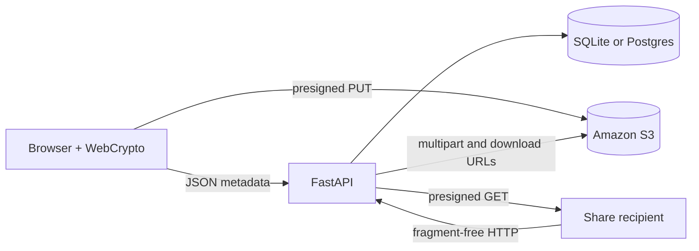

# VaultDrop

[Leia em portugues](README.pt-BR.md) | **English**

 

Secure, resumable file sharing on S3 for teams that want expiring links and client-side encryption without uploading plaintext.

## Why it exists

Presigned S3 uploads remove the application server from the data path, while resumability and SHA-256 verification make uploads reliable. VaultDrop combines those primitives with short-lived or download-limited shares, Argon2 password checks, SQLite/PostgreSQL metadata, and WebCrypto AES-GCM. The difficult parts are exact multipart part planning, atomic download limits, and avoiding trust in a browser-computed key or checksum.

## Architecture



The encryption key and IV data stay in the URL fragment. Fragments are not sent in HTTP requests. Passwords protect the share record with Argon2; they are never sent to S3.

## Quickstart

```bash
uv sync --python 3.12
cp .env.example .env
uv run uvicorn vaultdrop.api:app --host 127.0.0.1 --port 8000
```

Open `http://127.0.0.1:8000`.

For an entirely local S3-compatible stack:

```bash
docker compose up --build
```

The app listens on `127.0.0.1:55001`; Moto S3 listens on `127.0.0.1:55000`.

## API example

```text
POST /v1/uploads
{"filename":"brief.txt","size_bytes":29,"sha256":"831f9b...","part_size":8388608}

200 {"upload_id":"...","part_count":1,"urls":[{"part_number":1,"url":"https://..."}]}
```

Complete the multipart upload and create a protected share:

```text
POST /v1/uploads/{upload_id}/complete
{"parts":[{"part_number":1,"etag":"..."}]}

200 {"file_id":"...","sha256":"831f9b..."}

POST /v1/files/{file_id}/shares
{"password":"replace-me","expires_in_seconds":3600,"max_downloads":5}
```

## Design decisions

- **Presigned direct I/O:** application bytes never pass through FastAPI, and multipart URLs expire in 15 minutes.
- **Streaming checksum:** upload completion hashes the assembled S3 object rather than trusting only the browser.
- **Atomic redemptions:** a conditional SQL update claims a download slot; a second concurrent request cannot exceed `max_downloads`.
- **SQLite and PostgreSQL:** SQLAlchemy isolates the metadata layer. SQLite is for local use; PostgreSQL is recommended for shared deployments.
- **SSE audit stream:** `/v1/audit/events` exposes the latest actor-visible audit actions as server-sent events.
- **Encryption UI:** WebCrypto AES-GCM creates a per-file 256-bit key. The key is exported only into the URL fragment and is never persisted by VaultDrop.

## Testing

Moto-backed integration tests exercise multipart initiation, completion, checksum failures, password shares, quotas, and a two-thread download-limit race. Hypothesis property tests verify multipart range and part-count behavior. Strict Ruff and mypy checks run in CI.

```bash
uv run ruff check .
uv run mypy --strict vaultdrop tests
uv run pytest tests -q
tofu fmt -check -recursive terraform
tofu -chdir=terraform init -backend=false
tofu -chdir=terraform validate
```

The test run on this Apple Silicon laptop produced `6 passed`.

## Limitations

The included identity header is suitable for local demos, not remote authentication. Production deployments need an identity provider and authorization layer. The UI demonstrates encryption and sharing but is intentionally not a production key-management system. The IaC stack creates infrastructure but is not applied. Cross-region KMS policy and database migration tooling are outside this first implementation.

## License

MIT. See [LICENSE](LICENSE).

Built by [Chico Oliveira](https://github.com/FrancisWorld)
