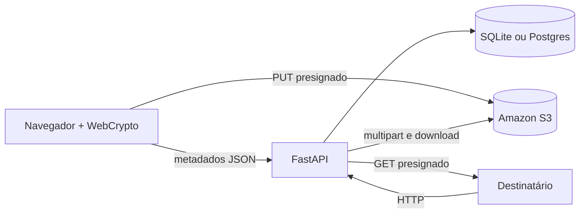

# VaultDrop

[Read in English](README.md) | **Português**

 

Compartilhamento seguro e retomável de arquivos no S3, com links expirados ou limitados e criptografia no navegador.

## Por que existe

URLs presignadas mantêm os bytes fora do servidor da aplicação, enquanto uploads multipart retomáveis e SHA-256 tornam o envio confiável. O VaultDrop combina essas peças com links de curta duração ou número limitado de downloads, proteção por Argon2, metadados em SQLite/PostgreSQL e AES-GCM com WebCrypto. Os pontos difíceis são o planejamento exato das partes, limites concorrentes de download e a verificação independente do conteúdo.

## Arquitetura



A chave de criptografia fica somente no fragmento da URL. Esse fragmento não é enviado ao servidor HTTP. Senhas são protegidas com Argon2 e não são armazenadas no S3.

## Início rápido

```bash
uv sync --python 3.12
cp .env.example .env
uv run uvicorn vaultdrop.api:app --host 127.0.0.1 --port 8000
```

Abra `http://127.0.0.1:8000`.

Para executar com S3 compatível localmente:

```bash
docker compose up --build
```

A aplicação fica em `127.0.0.1:55001` e o Moto S3 em `127.0.0.1:55000`.

## Decisões de projeto

- E/S direta com URLs presignadas; o texto plano nunca passa pelo FastAPI.
- A conclusão do multipart lê o objeto montado no S3 para verificar SHA-256.
- A reivindicação de um download usa atualização SQL condicional e atende concorrência.
- SQLAlchemy dá suporte a SQLite local e PostgreSQL compartilhado.
- Eventos de auditoria ficam disponíveis por SSE em `/v1/audit/events`.
- O navegador usa AES-GCM com chave única de 256 bits, exportada apenas no fragmento da URL.

## Testes

Os testes usam Moto e cobrem multipart, falhas de checksum, senhas, cotas e corrida de limite de downloads. Os testes Hypothesis cobrem o planejamento das partes. Ruff e mypy strict também são executados no CI.

```bash
uv run ruff check .
uv run mypy --strict vaultdrop tests
uv run pytest tests -q
tofu fmt -check -recursive terraform
tofu -chdir=terraform init -backend=false
tofu -chdir=terraform validate
```

Na execução deste laptop Apple Silicon: `6 passed`.

## Limitações

O cabeçalho `X-User-ID` é suficiente para demonstrações locais, não para autenticação remota. Produção exige provedor de identidade e autorização. A interface demonstra criptografia, mas não é um sistema de gerenciamento de chaves. A infraestrutura do OpenTofu não foi aplicada neste projeto.

## Licença

MIT. Consulte [LICENSE](LICENSE).

Built by [Chico Oliveira](https://github.com/FrancisWorld)
