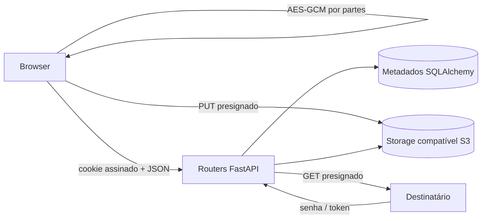

# VaultDrop

[Read in English](README.md) | **Português**

 

Compartilhamento retomável e criptografado no navegador, com uploads multipart no S3, sessões locais assinadas e links expiram ou limitados por downloads.

## Por que existe

As URLs presignadas não são o ponto difícil. O projeto prova propriedade por usuário, reserva de cota, partes multipart interrompidas, limites concorrentes e autenticação criptográfica no navegador.



## Início rápido

```bash
uv sync --locked --python 3.12
cp .env.example .env
uv run uvicorn vaultdrop.api:app --host 127.0.0.1 --port 8000
```

Use `POST /v1/auth/register` e o cookie HttpOnly assinado recebido. A interface fica em `http://127.0.0.1:8000`.

```bash
docker compose up --build -d
```

O app usa `127.0.0.1:55001`; Moto S3 usa `127.0.0.1:55000`.

## Decisões

- Senhas Argon2 e cookies HMAC locais substituem o cabeçalho `X-User-ID`.
- Routers, serviços, repositórios, S3 e planejamento têm responsabilidades separadas.
- O estado registra ETag e SHA-256 por parte, permite listar e retomar partes e torna completação/abortamento idempotentes.
- A verificação final lê o objeto do S3 em blocos de 1 MiB.
- Cota reserva bytes na transição iniciada e conta uploads ativos não finalizados.
- Links validam expiração, limite de downloads e tentativas de senha com atualização SQL concorrente.
- AES-GCM usa nonce único por parte e índice da parte mais `final` no AAD; a chave fica no fragmento da URL.

## Testes

O resultado local mais recente teve 15 testes Python aprovados e 91% de cobertura no laptop Apple Silicon. Foram aprovados 4 testes Node para tamper, reordenação e truncamento. OpenTofu foi inicializado e validado sem aplicar infraestrutura.

O build/start do Docker Compose foi tentado localmente, mas não terminou dentro da janela de verificação; portanto não está declarado como verificado.

## Limitações

As sessões locais não substituem um provedor corporativo de identidade. SQLite é útil localmente, enquanto PostgreSQL oferece referências melhores de concorrência. URLs presignadas são temporárias e não substituem controles de autorização no bucket.

## Licença

MIT. Consulte [LICENSE](LICENSE).

Built by [Chico Oliveira](https://github.com/FrancisWorld)
