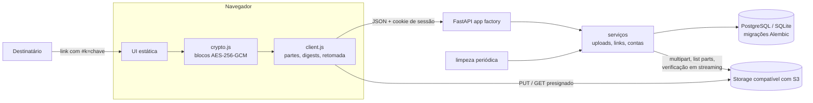

# VaultDrop

[Read in English](README.md) | **Português**

 

Compartilhamento de arquivos criptografado e com expiração sobre S3: o navegador cifra com AES-256-GCM, envia partes multipart retomáveis direto para o storage, e o destinatário decifra com uma chave que só existe no fragmento `#` do link.

## Por que existe

URLs presignadas são a parte fácil. O difícil são os pontos em que requisições concorrentes ou interrompidas quebram garantias em silêncio. Este projeto torna cada um explícito e o testa contra um banco real:

- **Limite de downloads e cota sob corrida.** Um link com `max_downloads=5` atingido por 25 requisições simultâneas entrega exatamente 5; dez reservas simultâneas de 400 MiB contra uma cota de 1 GiB admitem exatamente duas.
- **Tentativas de senha.** Palpites errados precisam ser contados mesmo que a requisição falhe, e contados com exatidão mesmo com 30 chegando juntos.
- **Estado multipart.** Uploads são interrompidos. Retomar exige a visão do storage sobre as partes, URLs presignadas novas, digests por parte e uma conclusão idempotente mesmo com duas abas disputando ou o servidor caindo entre "o storage montou o objeto" e "o banco confirmou".
- **Integridade sem bufferizar.** O servidor verifica o SHA-256 lendo o objeto em blocos de 1 MiB, gerando o digest do objeto e de cada parte numa única passada.
- **Formato criptográfico.** Cada bloco é autenticado com seu índice e um flag de final; reordenar, remover, duplicar ou estender blocos falha. A cifragem é determinística por chave de arquivo, então um upload interrompido pode continuar.



## Início rápido (SQLite, sem containers)

Os comandos abaixo foram executados em um notebook Apple Silicon (8 GB). O banco de desenvolvimento é SQLite; o storage pode ser qualquer endpoint compatível com S3, como `moto_server` ou a stack do Compose abaixo.

```bash
uv sync --locked --python 3.12
export AWS_ACCESS_KEY_ID=replace-me AWS_SECRET_ACCESS_KEY=replace-me
export VAULTDROP_S3_BUCKET=vaultdrop-local VAULTDROP_S3_ENDPOINT=http://127.0.0.1:9000 \
       VAULTDROP_S3_PATH_STYLE=true VAULTDROP_S3_BOOTSTRAP=true VAULTDROP_S3_SSE= \
       VAULTDROP_COOKIE_SECURE=false VAULTDROP_ALLOWED_ORIGINS=http://127.0.0.1:8000
uv run uvicorn --factory vaultdrop.api:create_app --port 8000
```

A aplicação migra o próprio schema ao iniciar (`VAULTDROP_AUTO_MIGRATE=false` para rodar `alembic upgrade head` manualmente). `VAULTDROP_S3_BOOTSTRAP=true` é uma conveniência de desenvolvimento que cria o bucket e as regras de CORS; na AWS a stack OpenTofu em `terraform/` cuida de ambos.

### Docker Compose (PostgreSQL + Garage S3 + app)

```bash
./scripts/dev-env.sh          # gera credenciais locais em .env (nunca versionado)
docker compose up --build -d  # app em http://localhost:55001, S3 em :55100
node scripts/e2e.mjs http://127.0.0.1:55001
docker compose down --volumes
```

A stack usa PostgreSQL 17, [Garage](https://garagehq.deuxfleurs.fr/) v2.1.0 (implementação real de S3, imagem fixada por digest) e a aplicação. **Status: não verificado neste checkout.** A VM do Docker disponível ficou sem disco e `docker compose build` falhou antes de qualquer container subir. O arquivo compose, `deploy/garage/`, `scripts/garage_init.py` e o job de CI correspondente (`compose-e2e`) não foram executados. As chamadas à API administrativa do Garage feitas pelo script de init (layout, importar chave, bucket, permissão) e o comportamento de multipart/list-parts/range/CORS foram exercitados manualmente contra o Garage v2.1.0 em uma sessão anterior, antes de o disco encher.

### O que foi realmente executado ponta a ponta

O mesmo script (`scripts/e2e.mjs`) rodou contra a aplicação real (uvicorn) em PostgreSQL 16 nativo, com `moto_server` como endpoint S3. Ele importa os próprios `crypto.js` e `client.js` do navegador:

```text
$ node scripts/e2e.mjs http://127.0.0.1:55001
- registered e2e-c5c7a610
- plaintext 20971643 bytes, sha256 5f7587b69f27988b...
- interrupted after part 1 (upload 49c3a123-8fcd-4b13-99b6-7456dac2db5b)
- resumed: 2 part(s) re-sent, stored 20972110 ciphertext bytes (sha256 e848250cf8545760...)
- share refuses a missing and a wrong password
- downloaded and decrypted: name restored, 20971643 bytes, sha256 matches
- wrong key rejected; download limit enforced
- audit trail: auth.registered, share.created, share.redeemed, upload.completed, upload.initiated, upload.part_recorded
e2e ok
```

Isso é Node, não um navegador: o código de DOM de `app.js` e o CORS real do bucket em um navegador não são cobertos por nenhuma verificação automatizada aqui.

## Esboço da API

| Etapa | Chamada |
| --- | --- |
| Conta | `POST /v1/auth/register`, `/login`, `/logout`, `GET /v1/auth/me` (cookie HttpOnly, SameSite=Strict) |
| Iniciar upload | `POST /v1/uploads` `{filename, size_bytes, part_size, sha256?}` + `Idempotency-Key` opcional |
| Retomar | `GET /v1/uploads/{id}` devolve as partes do storage e URLs novas para as faltantes |
| Digest por parte | `POST /v1/uploads/{id}/parts/{n}` (conferido com ETag e tamanho do storage) |
| Concluir | `POST /v1/uploads/{id}/complete`, `DELETE /v1/uploads/{id}` |
| Compartilhar | `POST /v1/files/{id}/shares` `{password?, expires_in_seconds?, max_downloads?}`, `DELETE /v1/shares/{id}` |
| Resgatar | `POST /v1/shares/redeem` `{token, password?}`, depois GET na URL presignada; `/s/{token}` serve a UI |
| Manutenção | `DELETE /v1/files/{id}`, `GET /v1/audit`, `POST /v1/uploads/expired/sweep` |

## Decisões de projeto e trade-offs

- **Sessões ficam no servidor.** Um token aleatório de 256 bits em cookie HttpOnly; só o SHA-256 é guardado, então logout e expiração são impostos pelo servidor e uma tabela vazada não serve como cookie. Não há segredo de assinatura que possa ficar com valor de exemplo. A checagem de Origin em requisições que alteram estado reforça o `SameSite=Strict`.
- **O rate limit é um registro no banco**, não memória do processo, então vale entre réplicas. A tentativa é confirmada antes da verificação Argon2 (lenta), sob um advisory lock do PostgreSQL por escopo e origem; é isso que torna verdadeiro "exatamente 5 de 30". Sucesso limpa o histórico. Senha errada (403) e limite atingido (429 com `Retry-After`) são respostas distintas; tokens têm 256 bits, então a existência do link não é um segredo relevante.
- **Vagas de download** são reservadas com um único `UPDATE ... WHERE downloads < max_downloads AND não expirou`. A vaga é consumida quando a URL presignada é emitida, não quando os bytes são baixados, e uma tentativa com a chave errada também consome uma; o servidor não tem como saber.
- **A cota** é verificada com `SELECT ... FOR UPDATE` na linha do usuário e soma arquivos armazenados mais reservas de uploads ativos. Reservas expiram com o upload (24 h por padrão) e uma rotina em segundo plano (mais um endpoint do dono) aborta no storage. Contadores de bytes são `BIGINT`: as colunas de 32 bits anteriores estourariam em 2 GiB no PostgreSQL.
- **PUTs presignados não limitam o tamanho da parte**, então o servidor compara os tamanhos listados pelo storage com o plano antes de concluir e recalcula o hash do objeto montado depois. Não dá para declarar 1 byte e guardar 5 GiB.
- **A verificação** aceita digest do objeto declarado antes (clientes de API), digests por parte registrados durante o upload (o navegador, que não consegue hashear um stream com WebCrypto), ou ambos; ao menos um é obrigatório. Divergência apaga o objeto, marca o upload como falho, libera a reserva, e a falha é confirmada antes de o erro ser devolvido.
- **Formato de cifragem** (`crypto.js`): `"VDR1"`, um cabeçalho autenticado com nome, tipo e tamanho do arquivo, depois blocos de 1 MiB com nonces de contador e (índice, final) como dado associado. O servidor nunca vê o nome real; guarda um nome opaco.
- **Locks em vez de tentativas.** A conclusão trava a linha do upload, então conclusões concorrentes devolvem o mesmo arquivo; se o servidor cair depois de o storage montar o objeto e antes do commit, a nova tentativa detecta o objeto e vai direto para a verificação.
- **SQLite é só para desenvolvimento**: toda transação é `BEGIN IMMEDIATE`, o que serializa escritas e faz os testes de corrida passarem trivialmente. É no PostgreSQL que eles significam algo, e o CI roda a suíte inteira nos dois.

## Estratégia de testes

| Camada | O quê | Onde |
| --- | --- | --- |
| Concorrência no banco real | limite de downloads, reservas de cota, limites de senha e login, conclusão, chaves de idempotência, registro de partes, cadastro, abort vs complete | `tests/test_concurrency.py` (SQLite e PostgreSQL) |
| Específico de PostgreSQL | colunas `BIGINT`, cascatas, advisory locks, migrações simultâneas de processos distintos | `tests/test_postgres.py` |
| Caminhos de falha | quedas do storage em cada operação, uploads sumidos, recuperação após falha pós-montagem, partes grandes demais, digests errados, uploads expirados, sessões forjadas, acesso entre usuários | `tests/test_uploads.py`, `test_shares.py`, `test_auth.py` |
| Migrações | schema igual aos modelos (drift do Alembic), upgrade, downgrade, idempotência | `tests/test_migrations.py` |
| Segurança | conteúdo da CSP, checagem de Origin, injeção de header, validação de nomes | `tests/test_security.py` |
| Propriedades | planejamento de partes e hash em streaming igual ao ingênuo (Hypothesis), memória limitada | `tests/test_planning.py`, `test_integrity.py` |
| S3 real via HTTP | retomada de multipart interrompido, falha de digest remove o objeto, abort, exposição do `ETag` por CORS | `tests/test_s3_integration.py` |
| Módulos do navegador | adulteração, reordenação, truncamento, extensão e chave errada; retomada sem reenviar partes; retentativas | `tests/*.test.js` (Node) |

Resultados nesta máquina (notebook Apple Silicon, 8 GB):

```text
ruff check . / ruff format --check .     limpo
mypy --strict vaultdrop tests            Success: no issues found in 42 source files
pytest (SQLite)                          146 passed, 8 skipped (testes só de PostgreSQL e S3 real)
pytest (PostgreSQL 16, nativo)           150 passed, 4 skipped (testes de S3 real)
pytest tests/test_s3_integration.py      3 passed, 1 skipped (CORS) contra moto_server via HTTP, em SQLite e PostgreSQL
cobertura (execução PostgreSQL)          94% de vaultdrop/ (s3.py é o menor, 76%; ramos de erro do storage)
node --test tests/                       27 testes, 27 passaram
tofu fmt -check / init / validate        limpo (nunca aplicado)
actionlint                               limpo
```

Não executados aqui: o job de integração com Garage e o teste de CORS (somente no CI), e o Docker Compose. O PostgreSQL 16 era o servidor disponível localmente; compose e CI usam o 17.

## Limitações

- A UI web é exercitada por seus módulos em Node, não em um navegador. Downloads decifrados são montados em memória, então arquivos muito grandes dependem da memória do navegador; o upload processa uma parte por vez.
- O Garage aceita mas não implementa SSE-KMS, então `VAULTDROP_S3_SSE` fica vazio no Compose. Na AWS vale o padrão `aws:kms` e a stack OpenTofu cria a chave. O Compose não tem TLS.
- A exclusão de arquivo remove primeiro os metadados; se a exclusão no storage falhar, o objeto fica órfão (registrado em log, inacessível). O bucket tem versionamento com expiração de versões antigas em 30 dias.
- O rate limit usa `request.client.host`; atrás de proxy, configure `--forwarded-allow-ips` no uvicorn. O cadastro é aberto (desligue com `VAULTDROP_ALLOW_REGISTRATION=false`) e não tem rate limit próprio.
- Sem e-mail, redefinição de senha ou painel de administração; cotas são por usuário e editadas no banco.
- A contagem de downloads é por resgate, não por transferência concluída.

## Licença

MIT. Veja [LICENSE](LICENSE).

Built by [Chico Oliveira](https://github.com/FrancisWorld)
